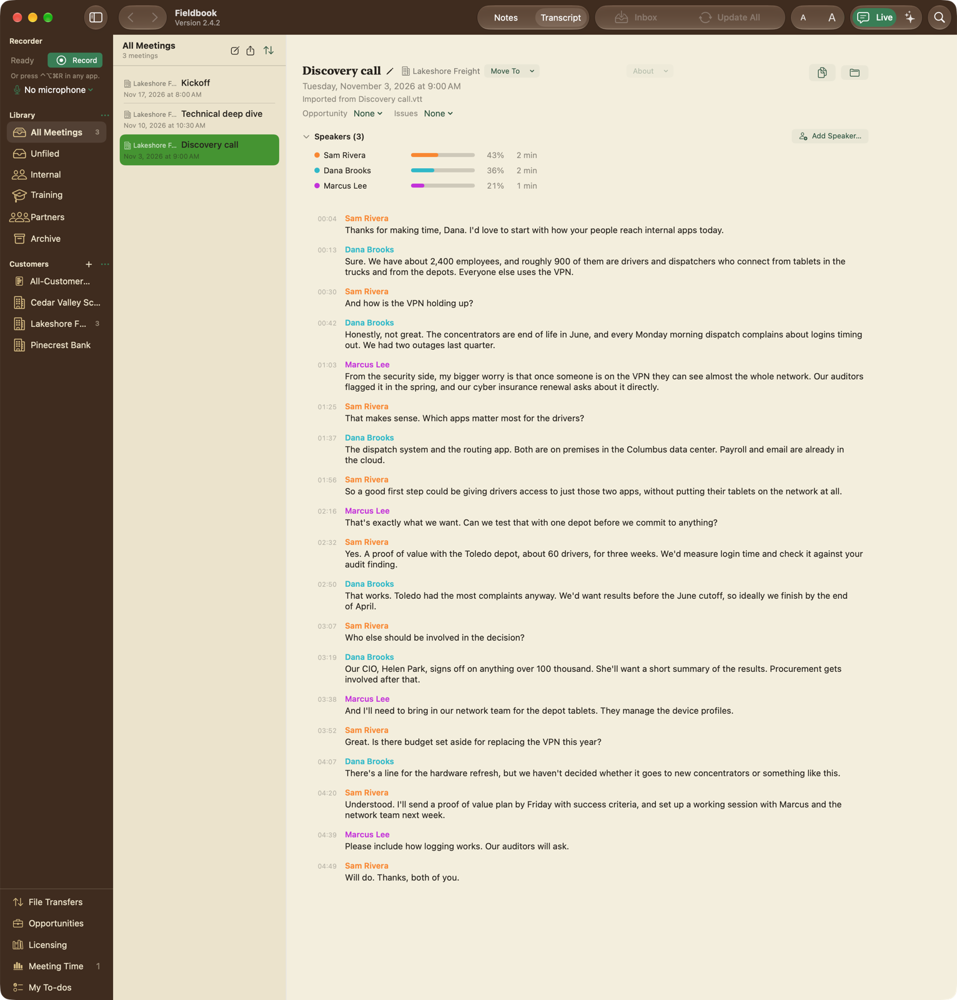

# Fieldbook

Fieldbook is a Mac app that records your meetings, transcribes them on your Mac, and writes meeting notes with the AI you choose. It's built for sales engineers, so meetings are organized around customer accounts and deals. No bot joins the call, and audio never leaves your Mac.

**This repository holds no source code.** It hosts Fieldbook's downloads (the DMG on each [release](https://github.com/ajawzero/fieldbook-updates/releases)) and the signed feed Fieldbook checks for updates.

## What it does

- **Records both sides of a call:** your microphone and your Mac's sound (Zoom, Teams, a browser, anything) as two tracks. Fieldbook notices when a call starts and offers to record, and stops when the call ends.
- **Transcribes on your Mac:** the speech model is built into the app, so transcription works offline. Speakers are found and labeled, and Fieldbook can recognize voices you've named before.
- **Writes notes with sources:** a summary, to-dos, and a follow-up email, each item linked to the transcript lines or your notes behind it. Use Apple's on-device model, a local model on your Mac, or a cloud AI service you set up.
- **Organized by customer:** recordings are filed by the email domains on the calendar invite. Each customer has an account summary, opportunities with their stage and MEDDPICC, discovery questions, files, and emails. A pre-call brief gets you ready for the next meeting.
- **Search and ask:** find any line across all your meetings, or ask a question and get an answer that cites its sources. You can also ask about one meeting in a column beside it.
- **Your notes and attachments** on every meeting, typed while you record.
- **Import and export:** bring in recordings from other recorders, and Zoom or Teams transcripts. Export meetings as zip files.
- **iPhone, iPad, and Android companions** (iPhone and iPad in testing): record in the room and sync with your Mac over your local network.
- **A second Mac:** pair it, and it shows and changes your first Mac's meetings, with notes and AI notes but never audio.

## Privacy

- Recording, transcription, speaker detection, search, and your library work on your Mac without a network connection.
- With the on-device model or a local model, nothing leaves your Mac. With a cloud AI service, only text (transcripts, your notes, and meeting details) goes to the service you set up, never audio or voices.
- No account, telemetry, or analytics. The daily update check sends only the app's version, and you can turn it off.
- The iPhone and iPad app's privacy notice: [privacy.html](https://ajawzero.github.io/fieldbook-updates/privacy.html).

## Requirements and install

- A Mac with Apple silicon and macOS 15 Sequoia or newer, with about 2 GB of disk space plus room for recordings.
- Download the DMG from the [latest release](https://github.com/ajawzero/fieldbook-updates/releases/latest), open it, and drag **Fieldbook** to **Applications**. It's signed with Developer ID and notarized by Apple.
- Fieldbook updates itself and asks before installing.

## What's in this repository

- `appcast.xml`, served at https://ajawzero.github.io/fieldbook-updates/appcast.xml: the signed list of versions that Fieldbook 1.8 and newer checks for updates.
- Releases: each version's DMG and its delta updates. Each update is signed with Fieldbook's update key and with Developer ID, and Fieldbook checks both before installing.
- `privacy.html`: the iPhone and iPad app's privacy notice.
